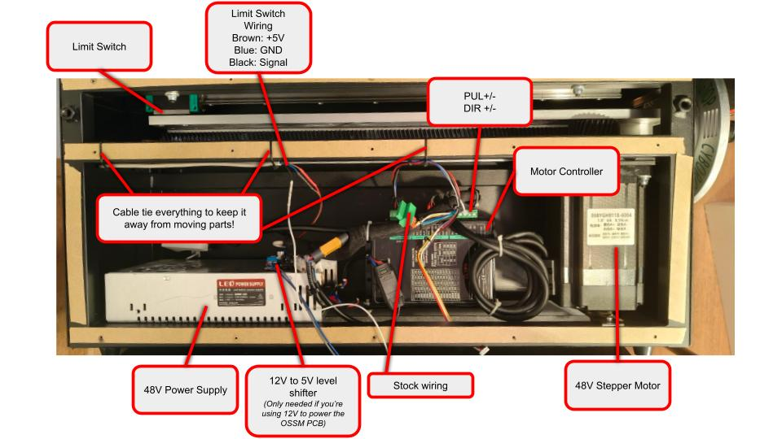
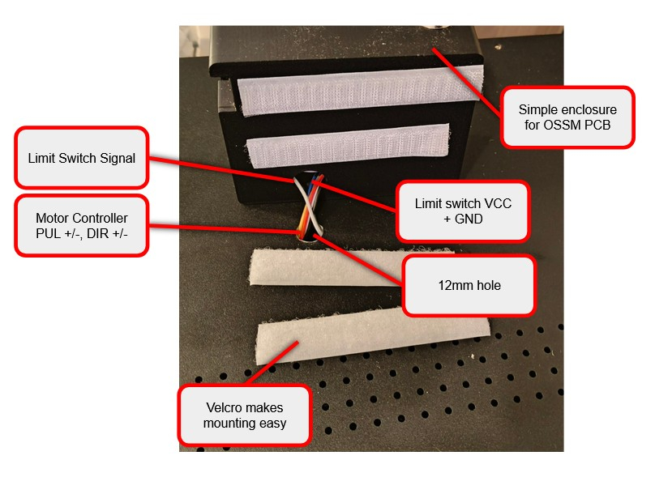
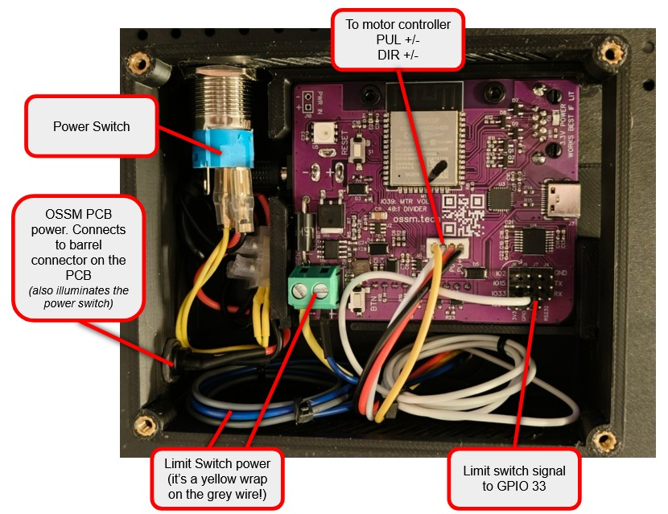

# ZeroNull CyborgTop Firmware
This is a fork of the very excellent [OSSM Lite formware](https://fray-d.github.io/OSSM-Lite/) specifically for CyborgTop machines. This firmware supports the 'classic' CyborgTop models and _not_ the CyborgTop 360 (yet!).

## What's new?
This firmware adds a few tweaks on top of the OSSM Lite firmware:
 - Support for homing with the CyborgTop mag switch
 - A few safety features:
   - Requires speed to be set to zero before starting a pattern
   - Smoothly returns to 'min' when entering the pattern menu
- A new 'User Calibration' mode to quickly set your Min and Max with minimal messing around

## What's planned?
I've got a few other features in mind:
 - Menu overhaul to make things quicker and easier to navigate
 - HTTP API to sit alongside BLE
 - CyborgTop 360 support (when I get my hands on one!)

## ⚠️ Warning
Following the steps in this guide involves making (reversible) changes to the insides of your CyborgTop machine. This will invalidate your warranty. You'll also be running code you found on the internet on a powerful machine prodding your sensitive bits. Use common sense, make sure you fully understand what you're doing, and if in doubt...ask!

## Let's get started
Make sure you read through __all__ of the steps below __before__ starting. Note this is just what I did for my build - feel free to do your own thing. Go nuts!

### Skills you'll need
 - A very basic knowledge of electronics - ie. understanding the difference between +5V and GND, knowing how to use a multimeter and how to strip wires.
 - Basic competency with a drill
 - Ability to flash firmware to the OSSM PCB (do it from source - it's more fun!)


### Items you'll need
You'll need the following items in order to complete this guide:
 - An OSSM reference board (though in theory any ESP32-WROOM based dev board will brobably be fine. Probbaly.)
 - OSSM motor wiring harness (or something with a cable compatible with the connector on the underside of the PCB, with sensible lengths on the wires)
 - A means of supplying +5V to the mag switch on the OSSM. If you are running your OSSM PCB on 5V, you can use this directly. If you're running the PCB on 12V, you'll need something to convert. In either case, use the Servo Power block (green) on the PCB to obtain the same voltage you're providing into the barrel jack.
 - A means of connecting the limit switch to one of the GPIO pins on the PCB (a length of sensible gauge wire with a crimp connector on the end)
 - A drill with suitible bit to put a nice clean hole in the side of the CyborgTop (12mm or so)
 - A few (small) terminal blocks, for connecting wires together (and putting things back if you want to reverse your changes)
 - Cable ties to keep everything neat and away from moving parts
 - Optional: 3D printed enclosure for the board (see the 3dprint folder for some inspiration)
 - Optional: Velcro strips to attach your enclosure to the board
 - Optional: Power button
 - Optional: A longer cat6 cable - the default one provided with the OSSM remote isn't quite long enough

### Overview
Let's spend a few moments covering what we're going to be doing here.
Your stock machine has a few key components:
 - 48V power supply - provides power to the motor, motor controller and remote
 - 48V stepper motor - a powerful precision motor used to move the arm
 - Motor controller - drives the stepper motor
 - Limit Switch - lets the remote know when the arm has homed to it's minimum position
 - Remote - provides instructions to the Motor controller, +5V power to the limit switch, and takes input from the switch so the machine can be homed. __This is the part we're going to replace__.

Stepper motors like the one in your machine are relatively complex devices - they not only draw a huge current, but also require a tonne of complicated maths to make them both move in the way you want, and also to hold their position and not drift over time. The motor controller in your CyborgTop is a dedicated piece of hardware which reliably does exactly this. It receives instructions from the remote in the form of 'pulse' and 'direction' messages, which are sent to the PUL +/- and DIR +/- pins on the controller.

It's this mechanisam we're going to borrow so the OSSM PCB can move the motor. This means we don't need to modify your original remote in any way.

 Your OSSM Board is designed to drive up to a 24V motor. OSSM by default also does not use a limit switch to find it's home position - instead it measures the power draw of the motor to detect when it begins to 'strain' against the backstop.

 Because the CyborgTop motor is double the power the OSSM PCB can provide, we're going to bypass the power supply feature of the PCB and instead power the motor directly. This means you'll need to power the OSSM PCB separately to the CyborgTop through it's barrel jack (unless you want to get really creative and step down from 48V to ~12V, then again to 5V for the OSSM PCB and limit swith respectively. It's not worth the faff - just go for a second independent 5V power supply!)

 Because we're not going to be powering the motor through the OSSM PCB, it'll have no way to know what power the motor is drawing...so we'll need to use the limit switch already present to let us know when we're home.

### Wiring
Here's how we're going to wire things up:
 ```
 [+5V]=>[PWR SW]=>[OSSM PCB SERVO+]───[*]───[VCC   LIMIT SWITCH]
                  [         SERVO-]─────────[GND               ]
                  [         GPIO33]─────────[SIGNAL            ]
                  [               ]
                  [           DIR-]─────────────────────────┐
                  [           DIR+]───────────────────┐     │
                  [           PUL-]─────────────┐     │     │
                  [           PUL+]───────┐     │     │     │
                                          │     │     │     │
 [Mains Power]===>[PSU   GND]────────┐    │     │     │     │
                  [     +48V]──┐     │    │     │     │     │
                               │     │    │     │     │     │
 [Motor Controller            +48V  GND  PUL+  PUL-  DIR+  DIR-]
 
 * If you use +12V to drive the OSSM PCB, like I do, you'll need a 12V -> 5V level shifter here. I hide mine inside the CyborgTop, stuck on top of the stock PSU
 ```

 Here's how it looks in my machine:

Key things:
 - Your motor controller may look a little different - don't worry!
 - You might want to use terminal blocks instead of soldering wires (such as the limit switch wiring) like I have, as it'll make it easier to reverse your changes later
 - I've got a level shifter in mine - you'll only need that if you need to step down to 5V from your OSSM PCB for the limit switch

 
Be careful about cable routing and placement - you'll want to keep your cables (expecially the limit switch signal cable) away from both the PSU and the stepper motor - otherwise you're likely to get a lot of false limit readings whilst homing!

Inside that enclosure, my setup looks like this:


# Step-by-step
Use the images and notes above to help you if you get stuck

## Act 1: Prepare the CyborgTop Machine
By the time you've finished these steps, you'll have the CyborgTop side of things ready.

1. 


